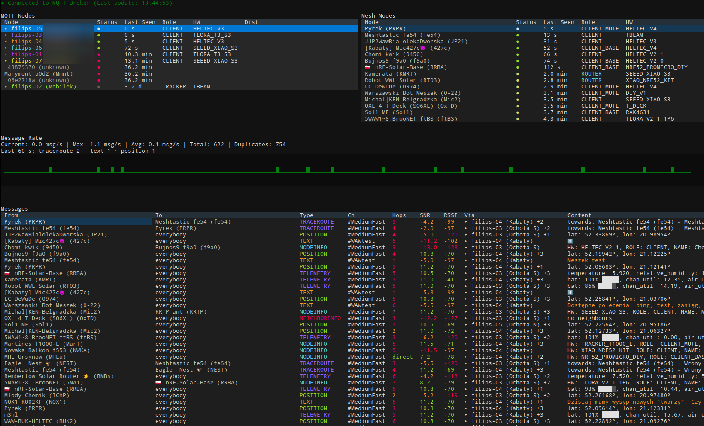

# Meshtastic MQTT console monitor

A [Textual](https://textual.textualize.io/) TUI that watches a Meshtastic MQTT broker: the JSON feed plus the binary protobuf topics (encrypted `/e/` packets and `/map/` reports). This is a complete new rewrite of the oryginal code.



## Setup

```
pip install -r requirements.txt
cp config.example.py config.py   # broker, credentials, node names
python3 meshmqttmonitor2.py
```

Options: `--config FILE`, `--topic TOPIC` (repeatable), `--db FILE`, `--no-log`,
`--replay LOG.sqlite [--speed N]`.

## Configuration

Copy `config.example.py` to `config.py` (or point to another file with `--config` / `MESH_CONFIG`).

- **Nodes:** one line per device, friendly name and color together (color is optional):

  ```python
  NODES = {
      "!da5aced8": ("my-node-01", "#c42cf0"),
      "!ffffffff": "everybody",
  }
  ```

  The older `ALIAS_MAP` / `COLOR_MAP` pair still works; `NODES` takes precedence.
- **Topics:** `MQTT_TOPIC` or a list in `MQTT_TOPICS` (or `--topic`). Next to a `.../json/...` topic the matching
  `/e/` and `/map/` topics are subscribed automatically (`DECODE_PROTOBUF = False` disables this). The topic root must
  match your nodes' root topic, e.g. `msh/PL/#` does not receive `msh/2/...`.
- **Encrypted channels:** `CHANNEL_KEYS = {"name": "base64key=="}`; the default key (`AQ==`) is always tried.
- Other options: `WATCH_NODES`, `LOW_BATTERY_PERCENT`, `OFFLINE_MINUTES`, `MENTION_WORDS`, `HOME_POSITION`,
  `LOG_RETENTION_DAYS`, `NODE_RETENTION_DAYS`, `DB_PATH`, `USE_SSL`, `TLS_INSECURE`.

## Keys

| Key                   | Action                                                               |
| --------------------- | -------------------------------------------------------------------- |
| `Enter` on a node     | node detail: position, telemetry sparklines, links, recent messages  |
| `/`                   | search messages (sender, type, text); `Enter` applies, `Esc` cancels |
| `t`                   | cycle message-type filter; `x` clears filters                        |
| `p`                   | pause / resume the message table                                     |
| `h`                   | chat view (text messages only)                                       |
| `n`                   | radio links (who hears whom, from neighborinfo and traceroute)       |
| `g`                   | export node positions to a GPX file                                  |
| `r` / `c` / `d` / `q` | reconnect / clear data / toggle debug / quit                         |

## What is shown

- *MQTT Nodes* lists gateways (whoever uplinked to the broker); *Mesh Nodes* lists the originators heard over radio.
- The debug window is a scrolling log (last 500 lines).
- Packets heard by several gateways are merged (`Via` shows the gateway and `+N` others).
- `Hops` is `hops_away` (0 = direct), `SNR` / `RSSI` are from the best gateway.
- Everything is logged to `mesh_log.sqlite`; the node lists, node info, telemetry and the last
  packets are restored on restart, and a log can be replayed with `--replay`.
- Alerts (notifications) for watched nodes: low battery and silence; optional mention words.

## Tests

```
pip install pytest
python3 -m pytest tests
```

`nodes_db/fetch_liam.sh` + `nodes_db/import_nodes_liam.py` import node names from the Liam Cottle map.
